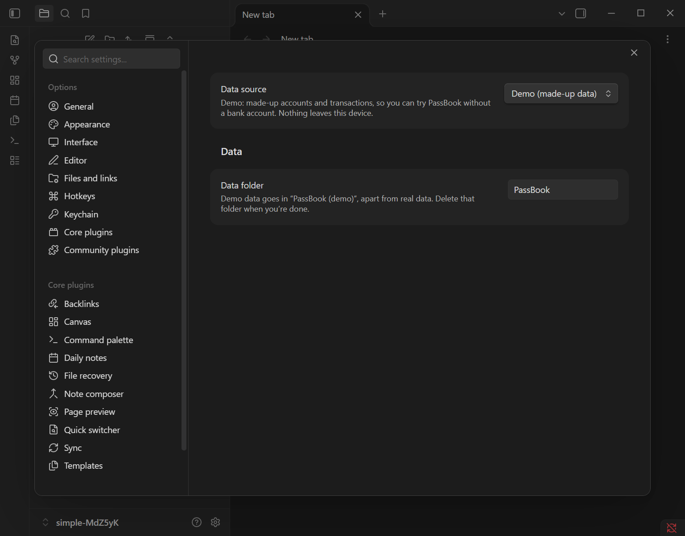
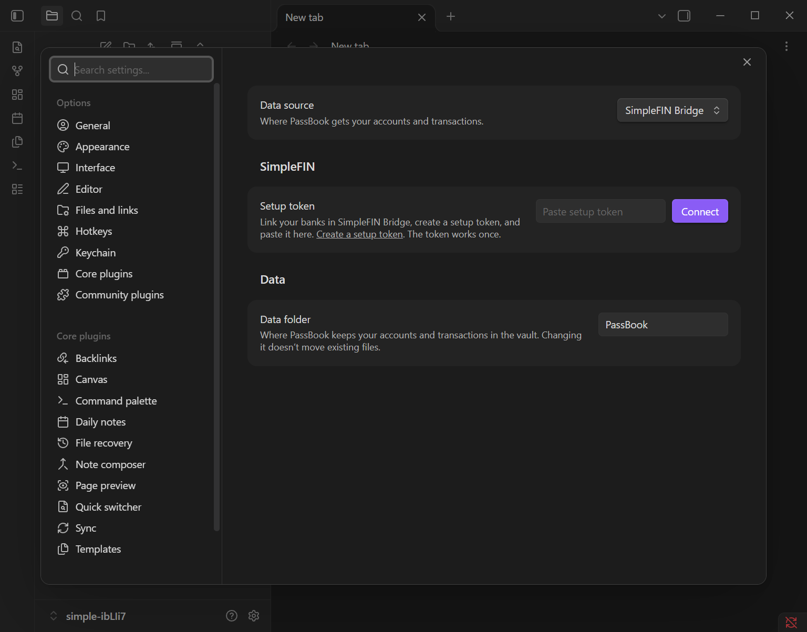
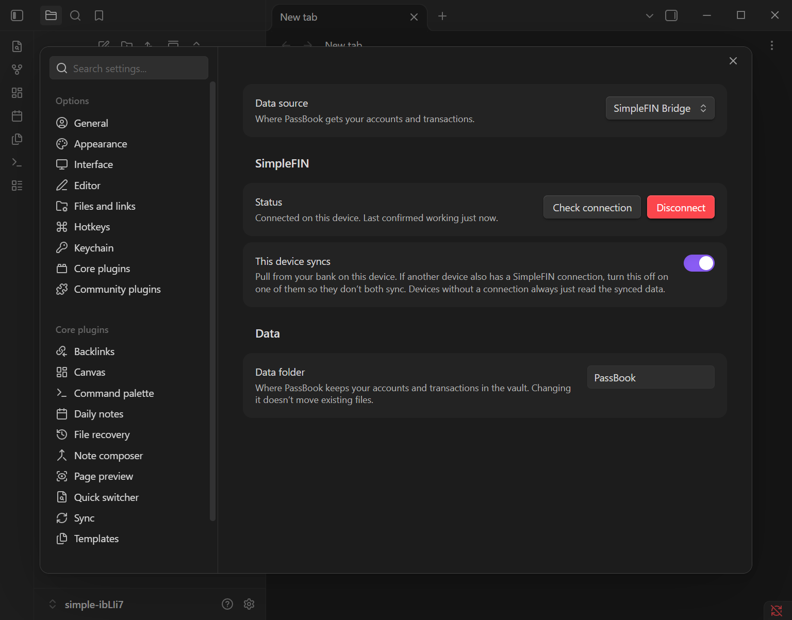
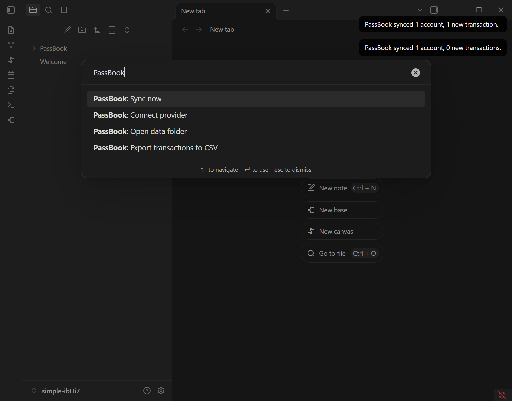
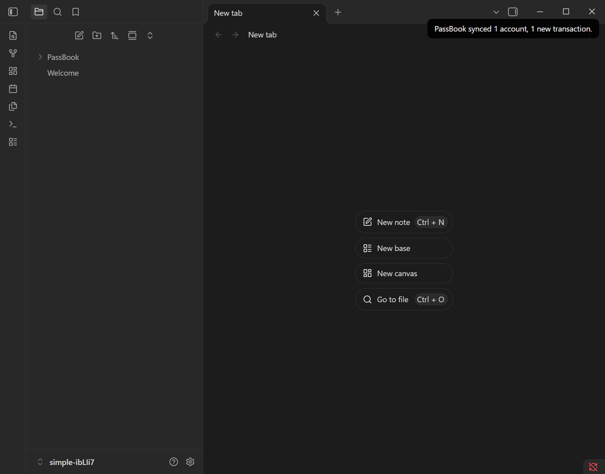

# Getting started

From nothing to your bank data in your vault, in about ten minutes. You'll need a
SimpleFIN Bridge account (paid, about $15/year). To look around first, skip to
[Try the demo](#try-the-demo).

## 1. Install PassBook

In Obsidian, open **Settings → Community plugins → Browse**, search for **PassBook**,
install it and select **Enable**.

## 2. Try the demo

Optional. In **Settings → PassBook**, set **Data source** to **Demo (made-up data)**,
then run **PassBook: Sync now** from the command palette. Made-up accounts and
transactions appear in a `PassBook (demo)` folder, with no account and no network use.

Set **Data source** back to **SimpleFIN Bridge** when you're ready for real data. The
demo folder stays where it is until you delete it.

## 3. Link your banks in SimpleFIN Bridge

[SimpleFIN Bridge](https://bridge.simplefin.org/) connects to your banks and hands the
data to apps you approve, such as PassBook. PassBook never sees your bank passwords.

1. Sign up at [bridge.simplefin.org](https://bridge.simplefin.org/) and start the
   subscription.
2. Follow its steps to link each bank and credit card you want in PassBook.
3. Create a **setup token** for PassBook:
   [bridge.simplefin.org/simplefin/create](https://bridge.simplefin.org/simplefin/create).
   It's a long string of letters and numbers. Copy it.

A setup token works **once**. If something goes wrong after you've used it, create a
new one.

## 4. Connect PassBook

Open **Settings → PassBook**. Under **SimpleFIN**, paste the setup token and select
**Connect**.

PassBook exchanges the token for an access key, keeps that key in Obsidian's secret
storage on this device, and checks it works. You should see this:

## 5. Sync

Open the command palette and run **PassBook: Sync now**.

The first sync fetches the last 90 days. A notice tells you how many accounts and new
transactions it found, along with any problem, such as a bank that needs you to sign in
again in SimpleFIN Bridge.

Sync whenever you like; each sync picks up what's new. Some banks don't report pending
charges through SimpleFIN, so today's spending may take a day or two to appear, once it
posts. SimpleFIN updates about once a
day, and PassBook makes at most 20 requests a day so your access never gets cut off.

## 6. Use the data

Your accounts and transactions are now JSON files in `PassBook/json/` in your vault.
For spreadsheets, turn on **Also save CSV files** in **Settings → PassBook**: CSV copies
appear in `PassBook/csv/` and stay up to date on every sync. **Folder layout** changes
where they go, and PassBook moves its files for you. Ways to use the data:

- **In notes:** the [daily bank note example](../examples/templater/passbook_daily.js)
  (a Templater script) adds balances and new transactions to each daily note. See the
  README.
- **In scripts and plugins:** [api.md](api.md) describes `api.v1`.
- **In a spreadsheet:** **PassBook: Export transactions to CSV**.
- **The raw files:** [schema.md](schema.md). **PassBook: Open data folder** shows where
  they are.

## Several devices

Connect PassBook on **one** device. Your vault sync carries the data folder to the
others, where PassBook and your scripts read it without connecting. The access key
never leaves the device that connected.

If you connect on a second device as well, turn off **This device syncs** on one of
them so they don't both pull from your bank.

## If something goes wrong

| PassBook says | What to do |
|---|---|
| "That isn't a SimpleFIN setup token" | Copy the whole token again from SimpleFIN Bridge. |
| "SimpleFIN says this setup token doesn't exist or was already used" | Create a new token. If you didn't use the old one yourself, disable it in SimpleFIN Bridge. |
| "SimpleFIN rejected PassBook's access" | The access was disabled in SimpleFIN Bridge. Select **Disconnect**, then connect with a new setup token. |
| "…subscription needs payment" | Renew in SimpleFIN Bridge. |
| "PassBook has made … of its 20 daily SimpleFIN requests" | Wait until the time it gives. |
| "This device is set not to sync" | Turn on **This device syncs**, or sync from your main device. |
| "…isn't valid JSON" or "…has no schemaVersion" | A file in the data folder was edited or only half-synced. Undo the edit, or let your vault sync finish, then sync again. |

Still stuck? Use **Report a problem** at the bottom of **Settings → PassBook**. It opens a
pre-filled report on GitHub with a diagnostic summary that has no personal details. Never
paste your setup token or anything from the data folder into a report.
